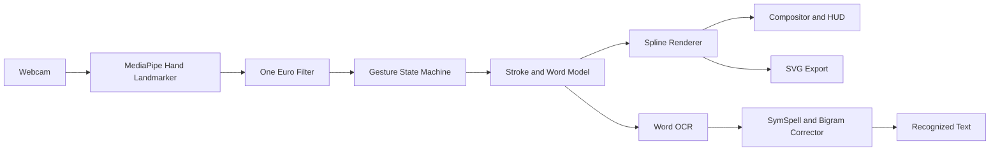

<div align="center">

# Smart Air Writer

**Touchless air-writing and spatial whiteboard, powered by computer vision and deep learning.**

Write, sketch, move and export handwriting in mid-air with nothing but a standard webcam.


</div>

<!-- Add a demo GIF here once recorded:
<p align="center"></p>
-->

---

## Overview

Smart Air Writer turns a webcam into a gesture-driven whiteboard. Hand landmarks are tracked in real time, filtered, interpreted by a gesture state machine and rendered as smooth vector strokes. Written words are recognized by a local OCR pipeline, corrected with a dictionary and language-context model, and can be exported as scalable vector graphics.

Everything runs locally. No paid API, account or cloud service is required.

## Table of Contents

- [Features](#features)
- [How It Works](#how-it-works)
- [Gesture Reference](#gesture-reference)
- [Keyboard Shortcuts](#keyboard-shortcuts)
- [Getting Started](#getting-started)
- [Project Structure](#project-structure)
- [Roadmap](#roadmap)
- [Contributing](#contributing)
- [License](#license)

---

## Features

### Gesture input

- **Dwell-to-write**: point with the index finger; a progress ring fills over 0.8 s before ink starts flowing.
- **Pinch-to-write**: pinch thumb and index finger together for immediate, zero-latency drawing.
- **Pen lift**: close the fist to end the current stroke and attach it to the active word.
- **Hover mode**: raise index and middle fingers to move the cursor without leaving ink.
- **Radial tool menu**: open the non-dominant palm to display a floating menu around the hand (colors, brushes, background, eraser, undo, clear).
- **Word manipulation**: pinch a committed word to drag it across the board, or fling it off-screen to delete it.
- **Commit gesture**: hold a thumbs-up for 0.4 s to commit the current word, insert a space and trigger learning.
- **Sponge eraser**: hold an open palm over the ink to erase the strokes beneath it.

### Recognition

- **Word-level OCR** with a local [EasyOCR](https://github.com/JaidedAI/EasyOCR) backend (ResNet, LSTM, CTC), able to read connected and cursive handwriting in a single pass.
- **Asynchronous inference**: OCR runs in a background thread so the video loop stays responsive.
- **SymSpell correction** with bigram context to resolve ambiguities such as `AZ1Z` to `AZIZ` or `2O25` to `2025`.
- **Automatic fallback chain**: EasyOCR, EMNIST-CNN, synthetic network, geometric rules.
- **Personal vocabulary**: committed words are learned and prioritized in later sessions.

### Rendering and export

- **One Euro Filter** on hand landmarks: removes jitter at rest while staying responsive during fast strokes.
- **Spline smoothing**: Catmull-Rom curves converted to cubic Bezier segments for clean, anti-aliased strokes.
- **Brushes**: Neon, Calligraphy (speed-sensitive width), Highlighter, Rainbow, Dotted.
- **Backgrounds**: live webcam, digital whiteboard, dark studio.
- **SVG export**: the whole board is exported as `<path>` elements with cubic Bezier commands, ready for Figma or Illustrator.
- **Video recording**: save sessions to MP4.

---

## How It Works



| Stage | Module | Responsibility |
|---|---|---|
| Tracking and gestures | `gesture_engine.py` | Landmark filtering, scale-adaptive pose estimation, gesture state machine |
| Interface | `bimanual_ui.py` | Radial menu and spatial word manipulation |
| Rendering | `spline_renderer.py` | Catmull-Rom to Bezier conversion, SVG export |
| Recognition | `air_keyboard.py` | OCR engine orchestration and fallback chain |
| Correction | `symspell_corrector.py`, `text_corrector.py` | Dictionary lookup, bigram model, sequence-level scoring |
| Online data | `online_tracker.py` | Trajectory features and calibration sessions |

---

## Gesture Reference

| Gesture | Action | Details |
|---|---|---|
| Index finger pointed (0.8 s) | Write | Dwell ring fills, then continuous ink |
| Closed fist | Pen up | Ends the stroke immediately |
| Index and middle fingers raised | Hover | Moves the cursor without drawing |
| Thumb and index pinched | Write / Grab | Instant drawing, or grab a word to move it or fling it to delete |
| Thumbs up (0.4 s) | Commit | Finalizes the word, inserts a space, triggers learning |
| Left open palm | Tool menu | Radial palette: colors, brushes, undo, clear |
| Open palm over ink | Sponge eraser | Erases strokes under the palm |

---

## Keyboard Shortcuts

| Key | Function |
|---|---|
| `Space` | Commit current word and add a space |
| `Tab` | Cycle through alternative OCR suggestions |
| `Backspace` | Delete the last committed character |
| `K` | Start or stop an online trajectory calibration session (A-Z, 0-9) |
| `N` | Cycle recognition mode: Auto, Digits only, Letters only |
| `B` | Cycle brushes |
| `W` | Cycle backgrounds |
| `P` | Export the board as SVG to `exports/` |
| `V` | Start or stop MP4 recording |
| `Z` | Undo the last stroke or word |
| `C` | Clear canvas and text |
| `1` - `5` | Select color: cyan, green, yellow, pink, white |
| `Q` | Quit |

---

## Getting Started

### Requirements

- Python 3.10 or 3.11
- A webcam
- Internet access on first run only, to download model files (MediaPipe, EasyOCR, and EMNIST if you train the optional model)

### Installation

```bash
git clone https://github.com/aziz11414/air-keyboard.git
cd air-keyboard

python -m venv .venv
# Windows: .venv\Scripts\activate
source .venv/bin/activate

pip install -r requirements.txt
```

### Run

```bash
python air_keyboard.py
```

Raise your hand in front of the camera to begin.

### Optional: train the EMNIST model

The EMNIST backend is used as a fallback when EasyOCR is unavailable.

```bash
python train_model.py               # auto-detect backend
python train_model.py --tensorflow  # CNN, higher accuracy
python train_model.py --sklearn     # MLP, lighter, CPU only
```

Trained models are written to `model/`.

---

## Project Structure

```
.
├── air_keyboard.py          Main loop, HUD and video compositing
├── gesture_engine.py        One Euro Filter, pose estimation, gesture state machine
├── spline_renderer.py       Catmull-Rom to Bezier conversion, SVG exporter
├── bimanual_ui.py           Radial menu and spatial word manipulator
├── symspell_corrector.py    SymSpell dictionary and bigram language model
├── online_tracker.py        Temporal trajectory processor and calibration engine
├── text_corrector.py        Sequence-level probability corrector
├── train_model.py           EMNIST training pipeline (TensorFlow and scikit-learn)
├── requirements.txt         Python dependencies
├── hand_landmarker.task     MediaPipe hand tracking model
├── model/                   Trained models
├── dataset/                 Calibration logs and trajectory datasets
├── exports/                 Generated SVG and MP4 files
└── web-app/                 Companion web / React client
```

---

## Roadmap

- [ ] **Online trajectory recognition**: a 1D-CNN / CTC model trained directly on stroke features (`x, y, dx, dy, speed, curvature`) collected with the calibration tool (`K`), removing the rasterization step and reading cursive from gesture dynamics.
- [ ] **ONNX export and web runtime**: port the gesture engine and temporal model to `web-app/` with `onnxruntime-web` for zero-install, in-browser use.
- [ ] **Depth-plane writing**: start a stroke by pushing the finger through a virtual plane, as an alternative to the dwell timer.
- [ ] **Multilingual corpus**: extend dictionaries to Spanish, German and Arabic, with vocabulary ingestion at runtime.
- [ ] **Session replay**: animated playback of strokes from their timestamps.
- [ ] **Virtual camera output**: use the board as a source in video-conferencing tools.

---

## Contributing

Contributions are welcome. To propose a change:

1. Fork the repository and create a feature branch.
2. Keep changes focused and describe the motivation in the pull request.
3. Open an issue first for larger changes, so the approach can be discussed.

Bug reports are most useful with your Python version, operating system, camera resolution and the console output.

---

## License

Released under the [MIT License](LICENSE).
